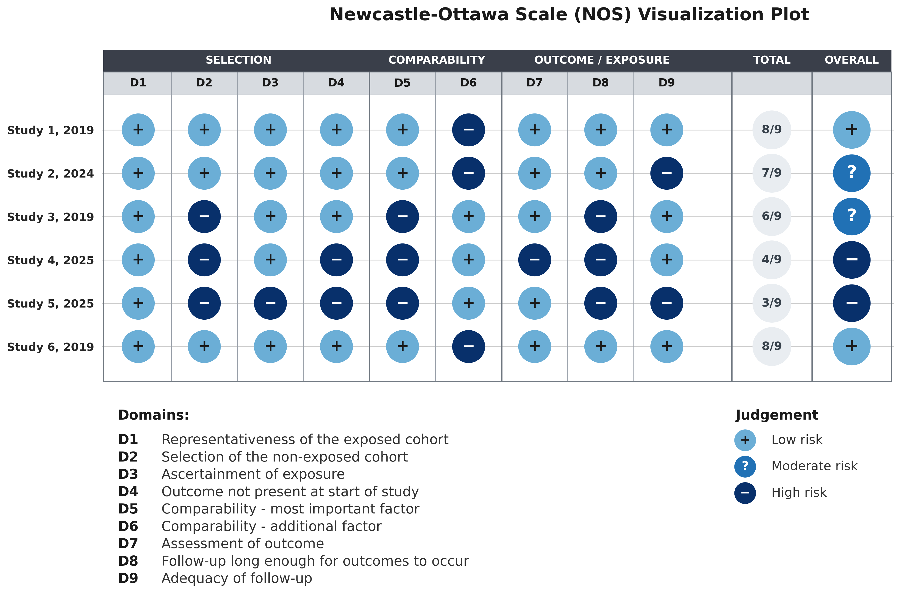
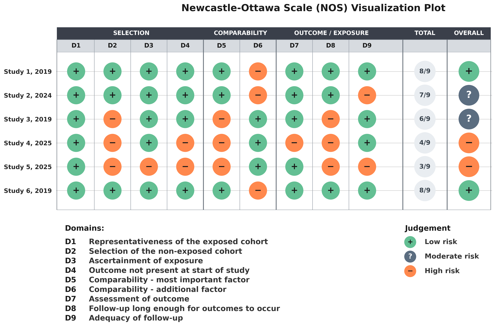

# NOS-TLPlot

Open-source Python tool for visualising **Newcastle–Ottawa Scale (NOS) risk-of-bias** assessments as publication-ready traffic-light plots and 13 specialized figures.

🌐 **Web:** [nos-tlplot.github.io](https://nos-tlplot.github.io)

📂 **Zenodo:** [10.5281/zenodo.17065214](https://doi.org/10.5281/zenodo.17065214) 

📃 **Metapaper (JORS):** [10.5334/jors.635](https://doi.org/10.5334/jors.635)


## Quick start

Run it in the browser at [nos-tlplot.streamlit.app](https://nos-tlplot.streamlit.app), or install the Python package from [PyPI](https://pypi.org/project/nos-tlplot/):

```bash
pip install nos-tlplot

# Command line
nos-tlplot sample.csv output.png
nos-tlplot sample.csv output.png gray
```

The Streamlit app and the full source live in the [main repository](https://github.com/aurumz-rgb/NOS-TLPlot).

Upload a CSV/Excel NOS table (see [example/](example)), pick a plot type and theme, and export as `.png`, `.pdf`, `.svg`, or `.tiff`.

**Features:** 13 plot types · traffic-light, grayscale, ocean and sage themes · CSV/Excel input · 300 DPI vector output.

## Themes

Four colour themes: `traffic_light` (default), `gray`, `ocean` and `sage` - selectable in the web app or via the optional theme argument on the command line.

| Theme | Low | Moderate | High |
| ----- | --- | -------- | ---- |
| `traffic_light` | `#2E7D32` | `#F9A825` | `#C62828` |
| `gray` | `#D6D6D6` | `#9E9E9E` | `#3C3C3C` |
| `ocean` | `#6BAED6` | `#2171B5` | `#08306B` |
| `sage` | `#63BF93` | `#5B6D80` | `#FF884D` |





## Input format

| Column | Range |
| --- | --- |
| `Author, Year` | text |
| Domains 1–4, 7–9 | 0–1 |
| Comparability (Age/Gender, Other) | 0–2 |
| `Total Score` | 0–9 |
| `Overall RoB` | Low / Moderate / High |

Stars → RoB: 

7–9 Low 
4–6 Moderate 
0–3 High.

## Citation

**Sahu, V. (2025).** NOS-TLPlot: Visualization Tool for Newcastle–Ottawa Scale in Meta-Analysis (v3.0.0). Zenodo. [10.5281/zenodo.17065214](https://doi.org/10.5281/zenodo.17065214)

**Sahu, V. (2026).** NOS-TLPlot: A Specialized Python Tool for Visualizing Newcastle–Ottawa Scale Risk-of-Bias Assessments. *Journal of Open Research Software*, 14(1), 7. [10.5334/jors.635](https://doi.org/10.5334/jors.635)

Apache-2.0 


Support: [Issues](https://github.com/aurumz-rgb/NOS-TLPlot/issues) 
